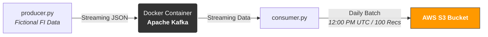

# Data-Pipeline
Data pipeline for data engineering project.

# 🏦 Daily Financial Transaction Data Pipeline

An event-driven data pipeline that simulates real-time financial transaction streams using Apache Kafka, containers, and batch storage in AWS S3. 

## 🗺️ System Architecture

## ⚡ How It Works & Performance Constraints
* **Data Generation:** `producer.py` creates fictional financial transaction records (JSON format) containing fields like `transaction_id`, `account_id`, `amount`, and `timestamp`.
* **Message Broker:** A Dockerized **Apache Kafka** instance acts as the event backbone, ingestion queue, and decoupled streaming layer.
* **Pipeline Schedule:** The process triggers **daily at 12:00 PM UTC** via a Cron/scheduler utility.
* **Batch Micro-ingestion:** The `consumer.py` script continuously reads from the Kafka topic, aggregates a batch of exactly **100 records**, and flushes them to the target S3 bucket as a unified file.

## 🛠️ Tech Stack
* **Language:** Python 3.11
* **Streaming & Event Broker:** Apache Kafka
* **Containerization:** Docker & Docker Compose
* **Cloud Storage:** AWS S3
* **Libraries:** `confluent-kafka` (or `kafka-python`), `boto3`, `faker`

## 📁 Repository Structure
├── docker-compose.yml     # Kafka & Zookeeper multi-container configuration
├── producer.py            # Generates and publishes fictional transactions
├── consumer.py            # Consumes Kafka stream and writes batch files to S3
├── requirements.txt       # Python dependencies
└── README.md
